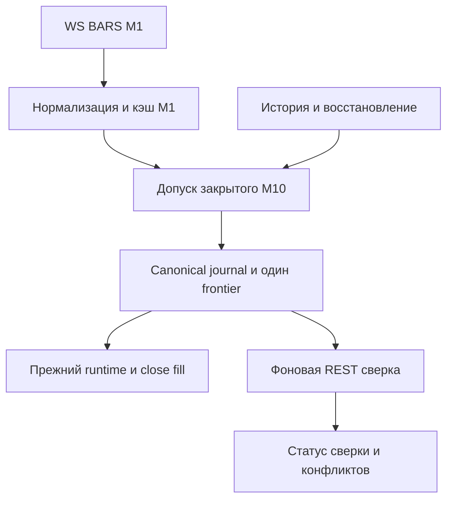

# Архитектурный review и ТЗ FINAM WS primary M10

Дата: 2 ноября 2026 года. Редакция R0. Адресат: разработчик FINAM gateway и signal-shadow.

**Решение:** основной рабочий источник M10 — поток FINAM BARS M1. REST обслуживает прогрев, подтверждение исключительных ситуаций, восстановление и фоновый аудит. Успешный REST-запрос на каждый M10 больше не является условием работы исправного WS-потока.

Пользователь согласовал это направление в диалоге. Ниже зафиксированы архитектурный review и достаточное задание на реализацию. Новый режим сначала квалифицируется в candle-only read-only shadow с прежними моделью и виртуальным close-fill. Этот документ не является source/release acceptance новой реализации или разрешением установки и запуска.

## 1 Основание и границы review

Проверен принятый source tree **73ac00b63b792d3e812b70846c64c7788e55190a** и диагностический пакет начальной BARS-посылки. Более нового source-кандидата для WS primary в распоряжении reviewer нет.

| Объект | Точная идентичность |
| --- | --- |
| Принятый Linux release | candle-bounded-reconnect-linux-release-20261102-r0.zip |
| SHA-256 release ZIP | 113d91840266e327ee00bad2dbbff7fdcd67363bf7ddf13e21eeec8e42739682 |
| SHA-256 принятого ELF | 92ed4f2918af7766e962045d6c76cbabea9f7756c96cd3dfb1c75b9e627f20c8 |
| Диагностический ZIP | candle-bars-first-frame-diagnostic-20261102-r0.zip |
| SHA-256 диагностики | 89c4fc897e52fb37fd5b36032dfe1c6649d2ab4d7db4b776d100c880ebecb732 |
| SHA-256 accepted ws.rs | 44d8d9f08a32f6fad219269458d0505e8a9cfcfed81e2b446799d4f6255688c2 |
| ALOR reference HEAD | a19124b98d601d7c583b3554d4beadad7ad82cdc |

Рассмотрены runner.rs, ws.rs, socket.rs, transport.rs, auth.rs, input.rs, session.rs, timing.rs, intraday.rs, prefix.rs, observer.rs, runner/recovery.rs, broker-finam/sparse_m10.rs, broker-finam/ws.rs и broker-core/observed_m1.rs. Из ALOR freeze использованы ws_hub.rs, supervisor.rs, data_quality.rs и конфигурация lifecycle. Freeze HEAD не объявляется побайтной копией ранее установленного ALOR image.

Это review архитектуры получения и допуска данных. Broker execution, ордера, риск-профиль стратегии и полная миграция торгового runtime в объём реализации не входят. VPS, P0/O3, Redis, принятые source/ELF и main не менялись. Новые Rust-тесты и operational-прогоны для ещё не реализованного режима не заявляются.

## 2 Выводы архитектурного review

Текущая схема работоспособна как отдельный квалификационный режим, но не реализует выбранную архитектуру WS primary. Замечания ниже относятся к переходу на новую архитектуру и не отменяют прошлые ограниченные source/release acceptance.

| ID | Приоритет для WS primary | Наблюдение в исходниках | Следствие и требуемое изменение |
| --- | --- | --- | --- |
| A1 | P1 | runner.rs создаёт обязательный REST worker по plan.requests. Event::Snapshot вызывает session.snapshot; provisional Event::Socket не передаёт BARS в модель | Рабочий M10 пока приходит из REST. Нужен самостоятельный WS admission и общий вход принятого canonical M10 |
| A2 | P1 | collect error становится runner_rest; jobs.join_next завершает общий work при ошибке worker | Фоновый REST audit нельзя добавлять в эту схему как ещё один обязательный worker. Его недоступность должна быть отдельным результатом |
| A3 | P1 | SnapshotFlag в ws.rs сводит missing к false; старая непомеченная строка получает TimestampBounds | Для bootstrap нужны сохранение presence и ограниченная проверка overlap по доверенной истории |
| A4 | P1 | broker-core/observed_m1.rs принимает только HistoricalPoll и содержит REST policy/domain; source completeness требуется до создания receipt | Нельзя переименовать WS в REST или выставить is_final=true по часам. Нужна отдельная capability WS admission с собственной provenance |
| A5 | P1 | input.rs кладёт open_ts M10 в HybridRuntimeBarEvent.close_time_utc; session.rs вычисляет nominal close как label+600s | Название legacy-поля вводит в заблуждение. Новый путь обязан сохранить начало интервала как метку модели |
| A6 | P1 | auth.rs устанавливает held до await; ошибка grant при очередном REST-запросе или reconnect терминальна для вызывающего worker | Разделить недоступность выдачи нового grant и отрицательную проверку прав. Здоровый существующий read-only socket не должен зависеть от фонового auth/audit |
| A7 | P1 | R1 восстанавливает транспорт; canonical gap replay явно исключён. intraday/prefix дают отдельные реконструкции | Для WS primary нужны сохранение frontier и позиционного состояния, восстановление пропущенных M10 и доказанная граница restart |
| A8 | P2 | Observer синхронно пишет и fsync каждый event; общий канал runner имеет ёмкость1 | Нельзя писать каждый высокочастотный update через модельный путь. Нужны ограниченный ingress/cache, раздельная обработка heartbeat и отсутствие скрытых потерь при backpressure |

Полезные механизмы уже существуют: точные source/config pins, account/readonly-проверки, отдельный WS lifecycle от JWT expiry, heartbeat, bounded reconnect, fencing поколений, unresolved recovery latch, модельный oracle и close-fill, intraday reconstruction, запрет перезаписи evidence. Их следует расширять, сохраняя принятые инварианты.

## 3 Целевая схема и распределение ответственности

Достаточен один processor данных в существующем процессе. Для одного instrument/timeframe он поддерживает один рабочий WS feed и единый canonical frontier; несколько runtime получают одни и те же принятые бары. Количество REST-запросов не должно умножаться на число стратегий.

История и восстановление могут использовать REST либо отдельно квалифицированный WS snapshot. Фоновый audit читает уже принятые данные; он не выдаёт разрешение на каждый модельный callback. Конфликт данных останавливает дальнейший допуск этого инструмента до выяснения, а timeout аудита оставляет результат сверки неизвестным.

Граница брокера располагается перед canonical input. FINAM DTO, auth, snapshot aliases и envelope остаются в адаптере. Модель получает прежний broker-neutral бар. ALOR reference используется для lifecycle, overlap/dedup, календаря и frontier; его GUID/CWS протокол и бесконечный reconnect буквально не переносятся.

## 4 Режим и неизменяемые параметры модели

Добавить явный opt-in режим ws_primary_v1 в версионированную конфигурацию. Прежний REST-driven режим остаётся отдельным совместимым режимом. Автоматического переключения между ними нет. Старый ELF обязан отвергать конфигурацию нового режима, а не исполнять её частично.

Режим, admission policy, параметры финализации и recovery включаются в config/source-policy fingerprints и evidence. SHA модели, reference и feedback не меняются из-за смены транспорта.

Сохранить:

- IMOEXF@RTSX, tick0.5 и lot1 в проверяемом mapping.
- Профиль imoexf-baseline07-bo-only-no-riskgate, существующие BO-параметры и виртуальный full fill по close.
- Четыре фактически полные сессии прогрева и отдельные raw/model календари.
- Labels M10 по началу фиксированного интервала. Например, бар07:00–07:10 имеет model label07:00 и nominal close07:10. Legacy close_time_utc на runtime boundary сохраняет label07:00.
- Текущие Lmax=10 000ms и clock uncertainty<=100ms. Сохранить фактическую проверку CallbackFence: задержка с uncertainty не больше Lmax, включая публикацию. Поздние результаты не превращаются в LIVE.
- Отключённые QUOTES и реальное broker execution в новом candle-only профиле.

Canonical digest OHLCV/label должен оставаться сопоставимым с прежним input::canonical_digest. Origin, generation и способ доказательства хранятся рядом, а не меняют числовые входы модели. Decimal используется до существующей контролируемой конверсии на runtime boundary.

## 5 Приём и хранение M1

### Wire validation

Проверять фиксированный endpoint, channel BARS, symbol/timeframe, привязку subscription к текущему owner/generation, размеры, timestamps и OHLCV. Поддержать уже наблюдаемые JSON object/string payload и допустимые snake/camel aliases.

Snapshot presence представлять как Missing, ExplicitFalse или ExplicitTrue. Null, другой тип, двойные aliases и конфликтующие поля не сводить к missing. Сохранить строгие future/subsecond/minute-alignment проверки и прежние live freshness predicates.

Каждый update BARS интерпретируется как состояние M1. По ключу instrument/timeframe/open timestamp он заменяет предыдущую версию. Повтор одного update не добавляет volume заново. Точные повторы увеличивают RX/duplicate counters, но не продвигают market watermark и не дают новую readiness. Необъяснимое изменение open или регресс уже принятой версии требует диагностики и остановки допуска; легитимность provider revision не угадывается.

### Bootstrap

Сохранить ранее согласованный контракт REST-verified overlap: marked true проходит validated history path; missing history допускается к discard только при точном совпадении с принятой M1 reference. Недостаточно совпадения агрегированного M10, возраста либо количества300.

Reference должна покрывать требуемые закрытые M1, включая хвост между model frontier и подключением. Текущий seed.json содержит агрегированные M10 и сам по себе такую M1 reference не предоставляет: передать отдельную source-admitted M1 inventory с независимо закреплённым диапазоном/hash либо получить её ограниченным GET. На утреннем старте учитывать предыдущую реальную торговую сессию, в том числе выходные; диапазон нельзя ограничивать последними часами календарного времени или выводить только из присланных WS строк.

Например, история до20:20 exclusive не покрывает M1 с label20:20, закрывшуюся в20:21. При необходимости допускается один дополнительный bounded GET на bootstrap поколения. Фактические request/receive times и response hash сохраняются. Timeout обязательного proof оставляет bootstrap недопущенным.

История не вызывает live callbacks/fills, не освежает DATA и не завершает recovery. Текущая открытая M1 проходит обычный provisional path. Весь mixed frame валидируется до изменения readiness или публикации live effects.

Bootstrap открывается один раз на каждую новую physical connection generation, включая reconnect. JWT renewal существующего socket его не открывает. После принятого fresh live DATA этого поколения исключение закрывается. Старый owner/generation не меняет кэш нового поколения.

### Буферы

Сохранить512 rows и256KiB cumulative bootstrap limits, с учётом полного mixed wire frame. Working M1 cache ограничить существующим пределом4096; подтверждённые старые записи разрешено удалять только за пределами нужного overlap/recovery inventory. Журнал остаётся источником committed frontier.

Для ingress задать ёмкость128 frames и максимальный возраст необработанного live frame2000ms. Это параметры нового режима, а не утверждение о лимитах FINAM. При исчерпании/переполнении либо потере кадра зафиксировать разрыв continuity и закрыть canonical admission; молчаливого drop нет. Синхронный fsync и медленный потребитель не должны останавливать polling heartbeat. STOP прерывает ожидание очереди и IO.

## 6 Самостоятельный допуск закрытого M10

### Отдельная capability

Ввести внутренний проверенный тип AdmittedCanonicalM10 с закрытым конструктором либо эквивалентную capability. Возможность десериализовать Bar или поставить is_final не даёт права модельного callback.

Предусмотреть происхождение WS_LIVE, REST_EXCEPTION и RECOVERY_BACKFILL. Для REST_EXCEPTION обязательна причина: STARTUP_PARTIAL, SPARSE_UNPROVEN, BOUNDARY_UNPROVEN или SESSION_END. Audit является отдельным результатом и canonical capability не создаёт.

Переиспользовать чистую математику агрегации и numeric validation; REST-specific domain/HistoricalPoll в ObservedM1Receipt не использовать для маркировки WS. В broker-neutral слое нужен отдельный source-policy/receipt путь. Admission возвращает различимые Ready, PendingProof/Degraded и RejectedIntegrity. Ожидание proof и audit unavailable обрабатываются до ObservedSession, чьи ошибки сейчас терминальны. Модельный метод принимает только admitted input и остаётся единственным местом продвижения frontier.

### Правило WS admission первой реализации

Для интервала [T,C), C=T+600s, самостоятельно допускать WS_LIVE только при одновременном выполнении условий:

1. T — следующий обязательный label из независимого model calendar; окно подписки/coverage начинается не позже T, bootstrap закончен.
2. Подписка текущего поколения была непрерывна на нужном интервале: нет receive/heartbeat fault, очереди с потерями, неопределённого owner, clock fault или unresolved recovery.
3. Присутствуют все десять различных M1 labels T..T+9min с валидными актуальными OHLCV. Первая версия не трактует отсутствие M1 как доказательство отсутствия сделок.
4. Получен admitted live update M1 с timestamp>=C этого поколения. Его фактический receive time B подтверждает продвижение event time за границу. Snapshot, чужой канал и Pong не являются таким подтверждением.
5. После B прошёл close_grace_ms; updates старого интервала внутри этого окна ещё учитываются. Значение R0 —1000ms. Seal раньше max(C,B)+1000ms запрещён.
6. Состояние по всем условиям перепроверено непосредственно перед единым commit. Callback и durable publication укладываются в прежний Lmax с uncertainty.

close_grace_ms=1000 — проверяемая клиентская policy, не обещание FINAM о неизменности свечи. Operational qualification должна сравнить результат с независимым closed-range reference. Если наблюдаются изменения после seal, нельзя автоматически увеличить grace либо переписать уже опубликованную свечу: режим не проходит эту квалификацию до объяснения/коррекции policy.

В receipt разделить last_component_received_at, boundary_received_at=B, canonical_ready_at и model_result_at. Для CallbackFence использовать реальное время приёма boundary proof либо завершающего REST proof, которое не раньше C. Нельзя подставить время timer/seal вместо фактического сетевого получения.

### Неплотные свечи и отсутствие подтверждения границы

Если M1 меньше десяти, нет continuity или не пришёл boundary proof, это отдельная неопределённость. Сначала дать WS время до C+3000ms на самостоятельный admission. Запрос не должен стартовать на каждом C только потому, что boundary DATA ещё не пришла. Если неопределённость сохраняется, возможен один REST closed-range запрос с причиной исключения, timeout<=5000ms и общим пределом прежнего Lmax. Это оставляет до1900ms после максимального ожидания/GET на модель, запись и clock allowance; фактическое нарушение fence всё равно запрещает LIVE.

При своевременном полном ответе агрегировать только реальные M1 по прежней sparse policy: фиксированные границы, первый actual open, последний actual close, max high/min low, сумма final volumes и minute_bitmap. Нулевые минуты и forward-fill не добавлять. Если WS успел самостоятельно завершить admission во время GET, единственный writer фиксирует один результат; поздний REST-ответ становится только сравнением, без второго callback. Отмена ненужного GET не даёт права переиспользовать частично допущенную transport capability.

Если подтверждение пришло в Lmax, допустим REST_EXCEPTION с честной provenance. Если позже — только RECOVERY_BACKFILL и отдельная процедура восстановления. Timeout не делает свечу валидной или невалидной: callback приостанавливается, WS и состояние продолжают наблюдаться в пределах run deadline.

Пустой M10 остаётся недопущенным по прежней policy. Исключение возможно только по отдельно заданному model calendar, а не из-за пустого ответа или тишины.

При intraday start первый bucket может начаться раньше подключения. Его подтвердить как STARTUP_PARTIAL; не объявлять полностью наблюдённым WS-интервалом и не пропускать ради следующего bucket. Следующие полные окна используют основной WS path.

### Повторы и поздние исправления

До seal обновляется кэш. После commit идентичный старый M10/overlap игнорируется как duplicate. Несовпадение любой уже опубликованной M1/M10 фиксирует CanonicalConflict: source hashes и оба значения сохраняются, новый admission инструмента приостанавливается. Повторного callback, изменения старого close-fill или молчаливого rollback нет. Ни WS, ни REST не объявляется автоматически виновным источником.

## 7 Readiness и роли REST

Readiness передать отдельными измерениями: TransportHealthy, SubscriptionDataReady, CanonicalReady, AuthCanOpenNewCommands и AuditStatus. Состояния data pipeline: Bootstrap, LiveReady, Recovering, Degraded и Hold. AuditStatus: NotScheduled, Pending, Match, Unavailable или Conflict.

| Событие | Canonical/model поведение | WS/процесс |
| --- | --- | --- |
| REST audit timeout при самостоятельно принятом WS M10 | Уже принятый бар сохраняется; AuditStatus=Unavailable; следующие исправные WS M10 продолжаются | Подписка работает; нет runner_rest termination |
| Обязательный bootstrap/gap/sparse proof не получен | CanonicalReady=false; frontier и модель не перескакивают через неподтверждённый label | Приём и bounded buffering продолжаются; по бюджету — Hold |
| Истёк Lmax следующего M10 | Не создавать поздний LIVE callback; нужен RECOVERY_BACKFILL | Транспорт и диагностические задачи остаются под контролем STOP |
| Data conflict или отрицательные auth permissions | Приостановить допуск; сохранить причину | Следовать соответствующему integrity/security HOLD |
| Закончились retries/deadline recovery | Hold, без новых модельных решений и автоматического нового run | Сохранить evidence; завершить по принятой terminal/STOP процедуре |

В read-only shadow пауза означает отсутствие новых модельных шагов на сомнительном диапазоне. При будущем live блокировка новых входов не должна завершать отдельный контур контроля открытых позиций/заявок. Реализация broker execution и его risk policy в это ТЗ не включена.

### Фоновый audit

По умолчанию сверять каждый шестой committed M10, то есть не чаще одного раза за60min на инструмент. Audit можно явно выключить. Не более одного pending audit и одного GET на выбранный слот, timeout<=5000ms; после отказа ждать следующего audit slot, не устраивать цикл повторов. Recovery proof имеет приоритет над audit.

Audit сравнивает M1 inventory/bitmap и OHLCV, затем canonical M10; равенства одного close недостаточно. Исторический audit не вызывает модель и не проходит через API, который придаёт позднему ответу LIVE authority. Все реальные времена сохраняются.

Audit worker возвращает типизированный результат Unavailable, а не критическую ошибку в общий jobs.join_next. REST audit failure не закрывает CanonicalReady. Счётчик недоступности и время последней успешной сверки видны отдельно. Ограничения будущего live по длительности отсутствия аудита принимаются в live execution policy.

### Целевая нагрузка

На dense непрерывном потоке: **ноль обязательных market REST GET на закрытие M10**. При включённом audit — максимум один плановый GET/час на инструмент. Прогрев, стартовый partial bucket, bootstrap tail, sparse/boundary/session-end exceptions и gap recovery считаются отдельно, с причинами и budgets.

Если фактическая реализация снова обращается в REST на каждом M10, переход к WS primary не считается выполненным. В отчёте показать доли WS_LIVE/REST_EXCEPTION/RECOVERY_BACKFILL и число запросов каждой роли. Нагрузку считать также по bytes/response time, а не только числу GET. Auth/schedule/account запросы учитывать отдельно.

## 8 Auth и lifecycle подписки

Для каждой новой REST-команды/WS subscription требуется действующий проверенный grant: actual expiry, exact account, readonly и необходимые permissions. Cached grant допускается только в пределах его реального срока и guard. Просроченный token для новой команды не используется; выдуманного продления TTL нет.

В существующем candle-only socket expiry JWT сам по себе не требует disconnect. Auth renew или сбой фонового audit не открывает новый bootstrap и не сбрасывает dedup/frontier. Обновление производится single-flight при необходимости новой команды/планового refresh; принудительное получение нового token на каждую M1 не вводится.

Разделить недоступность auth endpoint и отрицательный grant. Для уже открытого read-only WS при сетевой ошибке нового grant допускается продолжение validated BARS, пока транспорт/data admission исправны и binding не изменён. AuthCanOpenNewCommands=false до успешного нового grant. Такая доступность старого socket не обещается провайдером навсегда: при CLOSE/reconnect нужен действующий grant, а его отсутствие исчерпывает bounded recovery.

readonly=false, иной account, отозванные permissions, некорректный срок/формат grant или clock integrity fault не превращаются в transient audit failure. Они закрывают соответствующий security admission. Сохранять закрытую типизированную причину: transport timeout/unavailable, HTTP authorization failure, decode/validation failure и cancellation outcome различаются. Не снимать held на произвольной ошибке и не возобновлять выдачу команд из частично завершённого grant. После transient failure новая попытка grant допустима только как свежая single-flight операция с полной повторной проверкой, в бюджете запрошенной команды. Неизвестный класс ошибки трактовать как недопуск, а не как безопасный timeout. Секреты, token, account IDs, headers и server free text не попадают в public logs.

Сохранить heartbeat30/15s, отдельные transport idle70s и DATA diagnostics60s/hold1200s согласно принятой candle policy. Календарно допустимое отсутствие торгов не равно transport failure. Pong подтверждает только транспорт; не продлевает DATA freshness и не закрывает пробел M10.

## 9 Reconnect и восстановление canonical диапазона

Сохранить до3 попыток на episode, backoff1/2/4s, общий предел45s и до3 episodes/run. Auth/connect/subscribe/bootstrap/first fresh DATA входят в этот бюджет; run deadline и STOP имеют приоритет. До первого await синхронно закреплять исходный fault. Cancellation/abort не дают clean EOD при unresolved fault.

После разрыва сохранить модель, позицию, side-used, pending и последний committed canonical label. Новому поколению нужны собственные handshake, binding и admitted fresh DATA. История и Ping/Pong недостаточны.

Для gap получить closed range от последнего committed label с overlap2 M10 до фиксированного cutover; максимальный восстанавливаемый gap —6h внутри model session. Значения overlap/6h взяты из ALOR reference как клиентские ограничения. Объём/timeout ответа остаётся bounded. Более длинный gap требует отдельной cold reconstruction нового сегмента.

В R0 нормативный recovery source — validated REST history. Один GET без внутреннего retry loop на recovery plan; повтор новой попытки только в пределах общего episode budget. Только поддерживаемое реальным client разбиение частей допустимо и считается в request budget. Запросы одного диапазона объединяются single-flight.

Validated marked WS snapshot можно реализовать как альтернативный recovery source, если он явно покрывает весь требуемый диапазон и прошёл отдельные tests/qualification. Наличие300 строк или сравнение двух ответов одного backend полноту не доказывают. Эта альтернативная ветка не является обязательной для первого WS primary release и не должна задерживать его готовность.

Все overlap labels сверяются до продвижения. Старые committed labels не вызывают модель. Новые пропущенные labels проигрываются по порядку как RECOVERY_BACKFILL через прежнюю candle-only reconstruction и виртуальный close-fill. Исторический исполнитель использует отдельную source-bound reconstruction capability; реальные UTC/receive времена сохраняются, а live CallbackFence не обходится подстановкой часов. Они восстанавливают виртуальное состояние и могут содержать виртуальные fills, но не считаются новыми live сигналами и не дают права историческим реальным заявкам. Затем требуется текущая готовность потока; пропущенная часть сессии не становится full LIVE задним числом.

Транспортный recovery success и CanonicalReady — разные результаты. Если WS восстановился, а gap не подтверждён, модель остаётся приостановленной. Canonical gap закрепляется отдельным синхронным unresolved latch до первого await; свежие WS DATA не очищают этот latch. Разрешение возможно только после подтверждения диапазона и завершения необходимых canonical commits. После drain finalizer проверяет и transport, и canonical latch; abort во время resync не превращается в clean EOD.

## 10 Restart и однократность

Сохранять committed frontier, canonical digest, source policy и связь сегментов. Для каждого label фиксировать source receipt, model step, виртуальный feedback и завершение логической операции. Reconnect не создаёт новую модель и не обнуляет short/long.

Существующий fsync каждой JSONL строки полезен, но строка model_step сама по себе не доказывает завершённый цикл feedback/publication. Restart должен различать завершённую операцию и частичный хвост. Добавить явную commit boundary либо эквивалентный проверенный протокол.

При restart использовать validated committed prefix или принятую deterministic reconstruction с pin previous segment. Повторное построение внутреннего состояния имеет историческую provenance. Сохранённый output не перезаписывается; неоднозначный/повреждённый хвост не объявляется успешно завершённым. До разрешения неоднозначности — Hold либо изолированная реконструкция без новых live effects.

Протестировать crash до source receipt, после source receipt, после model step, после virtual fill и после commit, включая nonflat и pending. Если ошибка/превышение Lmax обнаружены после начала изменения модели, повторный вызов того же бара с новым временем запрещён: требуется честный incomplete и однозначное восстановление, а не retry callback. Логическая однократность candle callbacks/virtual fills в shadow не является гарантией exactly-once broker orders: последние потребуют отдельного StrategyRequestId/broker-truth контракта live.

## 11 Календарь и конец сессии

Raw FINAM schedule и model calendar проверяются отдельно. Required inventory не выводится только из присутствующих M1. Для текущего baseline07 обычный полный день содержит101 M10, последний label23:40, close23:50; фактический план запуска должен соответствовать принятому календарю этой даты.

В конце сессии нельзя бесконечно ждать M1 следующего интервала: её может не быть. Для последнего M10 использовать explicit SESSION_END closed-range proof: validated REST либо отдельно квалифицированный marked WS history snapshot после закрытия. Одного календарного времени и Pong недостаточно. Это одно исключение на сессию, а не возврат к REST на каждый бар.

Если proof не получен в Lmax, не выдавать поздний LIVE callback; EOD остаётся incomplete до отдельно квалифицированной recovery/terminal процедуры. Не продлевать run автоматически. Приёмка EOD сохраняет прежние требования полноты, отсутствия unresolved recovery, pending feedback и обязательного flat состояния. AuditUnavailable сам по себе не портит корректный WS EOD, но сохраняется отдельным статусом и не даёт заявления о parity.

## 12 Evidence и verifier

На каждую canonical публикацию сохранять run/segment/config/model/reference/feedback hashes, instrument, label/C, origin/reason, canonical digest, final M1 inventory и minute_bitmap, generation/continuity, boundary proof, actual receive/ready/result/durable-publication times и latency. В public projection оставлять только разрешённые числовые market fields и lifecycle facts.

Журналировать RX, valid/duplicate/history/rejected M1, последний frame/DATA/watermark/canonical label, gap range, queue age/loss, recovery attempts, auth readiness, audit status и REST counts по ролям. Критические source/commit записи не теряются; telemetry агрегируется с лимитом, чтобы обычные updates не переполняли output. Исчерпание лимита критического evidence закрывает admission.

Для независимой проверки WS admission нужны финальные M1 значения и boundary/generation receipts. Одних counts и hash несохранённого frame недостаточно для повторного расчёта OHLCV. На квалификационных окнах сохранить ограниченные обезличенные fixtures изменений около границ, включая поздние revisions. Raw headers/token и произвольные unknown fields не сохранять.

Verifier должен независимо проверять identity, source policy, последовательность labels, числовую агрегацию, mode/origin, Lmax, отсутствие повторных callbacks/fills, commit completeness, unresolved fault и worker/cgroup completion. REST_EXCEPTION не считать WS_LIVE, audit timeout не путать с отрицательным сравнением. Наблюдение здорового потока не выдаёт automatic recovery PASS.

STOP/EOD отменяют все IO/очереди/audit/recovery, закрывают сокеты и подтверждают drained workers. Unsubscribe при наличии действующего grant допустим как ограниченный best effort; его ошибка или недоступный auth не задерживает physical socket close и hard deadline. Приёмку штатного STOP и watchdog fallback различать как прежде.

## 13 Матрица обязательной приёмки

Каждая строка требует воспроизводимого позитивного или отрицательного результата. Количество тестов само по себе не заменяет сценарии.

| ID | Сценарий | Ожидаемый результат |
| --- | --- | --- |
| T01 | Dense M10, все10 M1, непрерывный WS, post-boundary DATA, grace | Один WS_LIVE callback, один digest/commit, правильные OHLCV/label |
| T02 | Любое число updates одной M1 и точные повторы | Volume считается один раз по финальной версии; duplicates не дают новую readiness |
| T03 | Один или несколько required M1 отсутствуют | Нет самостоятельного WS admission; SPARSE_UNPROVEN, без синтетических минут |
| T04 | Своевременный validated sparse REST proof | Прежняя sparse математика, REST_EXCEPTION и точный bitmap |
| T05 | Полностью пустой bucket или весь ответ | Нет придуманного flat M10; соответствующий Hold/calendar outcome |
| T06 | Попытка seal M10 до C; M1 с future/subsecond timestamp | Нет преждевременной публикации; плохая M1 отвергнута. Обычные forming M1 до собственного close разрешены как provisional |
| T07 | Есть Pong, наступил C, но нет boundary DATA | Нет WS_LIVE; BOUNDARY_UNPROVEN и bounded proof path |
| T08 | Updates старого bucket пришли до seal | Учитываются; одно итоговое значение M1/M10 |
| T09 | Изменение OHLCV после commit, включая REST mismatch | CanonicalConflict; исходный commit неизменен, повторного callback нет |
| T10 | Startup посреди M10 | STARTUP_PARTIAL; label не пропущен, partial не выдан за полный WS coverage |
| T11 | Explicit snapshot true, включая history-only connection | История не даёт SubscriptionDataReady/CanonicalReady/recovery success |
| T12 | Missing flag, exact trusted M1 overlap | Ограниченный discard с receipt, без model/fill/DATA refresh |
| T13 | Missing flag и непокрытый stale tail | Одно bounded reference чтение; timeout оставляет bootstrap недопущенным |
| T14 | Stale ExplicitFalse, null/nonboolean/dual aliases, неверный symbol/frame | Прежний строгий отказ, без coercion и частичного commit. Fresh ExplicitFalse остаётся обычным live update |
| T15 | Mixed frame history/live с плохой последней строкой | Никаких частичных readiness или model effects |
| T16 | REST audit timeout на двух последовательных исправных WS M10 | Оба M10 обработаны однократно, audit unavailable, WS продолжает работу |
| T17 | Audit выключен, network market REST stub запрещает регулярные GET | Dense рабочие M10 продолжаются; ноль canonical GET |
| T18 | Audit query завис/ошибка worker; WS admission завершился во время proof GET | Heartbeat/WS/model не блокируются; pending audit один, canonical callback один |
| T19 | Равный M10, но различающиеся M1 inventory | Audit обнаруживает различие, а не ограничивается close/hash M10 |
| T20 | Auth issue/details timeout при здоровом открытом read-only WS | WS продолжает validated DATA; новых команд с expired token нет |
| T21 | Новый grant readonly=false/account mismatch/permission loss | Security HOLD; нет применения правила transient network timeout |
| T22 | JWT истёк, существующая подписка продолжает DATA | Нет принудительного reconnect или повторного bootstrap |
| T23 | Реальный local-peer EOF/Close, fresh auth, новое поколение | Старый owner fenced; новый bootstrap и admitted fresh DATA, budgets соблюдены |
| T24 | Reconnect дал только handshake/history/Pong | Нет recovery success; bounded exhaustion/Hold |
| T25 | STOP/abort в backoff, auth, REST proof, queue, first DATA | Все задачи завершены; original unresolved cause сохранён, clean EOD запрещён |
| T26 | Gap с overlap содержит старые и новые labels | Старые сверены/дедуплицированы, новые один раз RECOVERY_BACKFILL |
| T27 | Gap содержит конфликт committed bar либо превышает6h | Никакого silent overwrite/reset/автоматического холодного live старта |
| T28 | Short/long и side-used до reconnect/restart | Состояние сохраняется, повторного открытия/виртуального fill нет |
| T29 | Crash в пяти точках source/model/fill/commit | Prefix/reconstruction однозначны; повреждённый хвост не даёт live continuation |
| T30 | Старое поколение прислало queued frame/Pong после нового | Ни cache, ни readiness нового поколения не изменены |
| T31 | Queue overflow, задержка ingress или медленный writer | Continuity loss виден; silent drop и heartbeat starvation отсутствуют |
| T32 | Ровно на Lmax/uncertainty и за границей, UTC step | Та же действующая fence semantics, нет подмены receive time |
| T33 | Пауза рынка, weekend, неполная фактическая сессия | Нет бессмысленного resubscribe и fabricated required bars |
| T34 | Последний M10/EOD без следующей M1 | Explicit SESSION_END proof либо честный incomplete; нет ожидания до завтра |
| T35 | Все canonical labels/flat/pending корректны, только audit unavailable | EOD с отдельным audit status, без ложного заявления о parity |
| T36 | Synthetic101 labels, но unresolved recovery/cancelled commit | Verifier отвергает clean EOD |
| T37 | 505 historical M10 и frozen Python reference | Прежние решения, причины, состояния и close-fill циклы совпадают при равных inputs |
| T38 | Несколько runtime одного инструмента | Один feed/admission/frontier, GET не умножаются, доставка не дублирует callbacks |
| T39 | Public export и faults stop/unlink/receipt/fsync | Остальные cleanup-действия выполняются; секретов нет, unknown outcome не PASS |
| T40 | Повтор из распакованного source/release пакета | Пути, fixtures, pinned policy и file-only verifier воспроизводимы |

Граничные проверки выполнить для grace999/1000/1001ms, исчерпания512 rows/256KiB, разных decimal представлений, недопустимого tick/volume, частичных JSON writes и невосстановленного pending. Использовать existing source test seams; production endpoint overrides не открывать.

## 14 Реализация и квалификация

### Итерация A Рабочий WS admission

Wire presence/bootstrap, M1 cache, dense finalizer, source-neutral admitted input, единственный session entry, REST exceptions/audit roles и разграничение auth network/security. Добавить source policy и evidence. Legacy режим остаётся отдельно выбираемым. До перехода к рабочему ws_primary_v1 режиму T01–T22 и соответствующие model regressions обязательны.

### Итерация B Continuity и завершение

Canonical gap recovery, restart/commit boundary, календарь/EOD, backpressure и terminal verifier. Закрыть оставшиеся сценарии T23–T40 и граничные случаи. Здоровый streaming demo итерации A не выдаётся за завершение всего ТЗ.

А и Б — порядок разработки внутри одного feature, а не требование двух установок или operational запусков. Достаточен один полный source handoff после обеих итераций. Промежуточный Linux release итерации А не требуется.

На реализацию не требуется отдельный новый design-пакет перед кодом: это ТЗ задаёт контракт. В полном source handoff предоставить точный diff/tree, тесты и mapping требований к файлам. Linux release связывается с принятым source, policy и ELF; source/release acceptance прежнего бинарника на новый режим не переносится.

Operational qualification проводится по одному заранее принятому execution-пакету и одному разрешению оператора на цепочку установки/preflight/наблюдения/STOP/export. Между этими шагами новых reviewer-приёмок не вводить. Недопуск или пропуск окна заканчивает попытку согласно её bounds.

Минимум для первого operational окна: три полностью наблюдённых WS_LIVE M10, matching heartbeat, числовая сверка с отдельно собранным FINAM REST reference и штатный STOP активных workers. Квалификационный reference сбор может быть чаще production audit, но только в явно ограниченной процедуре. Это сравнение источников одного брокера, не ALOR operational parity.

Затем полная сессия/EOD и следующий старт/restart с сохранением состояния, с отчётом о sparse/exception доле и фактической REST нагрузке. Auth rotation засчитывается только если требовалась и случилась; её отсутствие при отсутствии новых команд не является отказом WS primary. Natural reconnect при отсутствии отказа остаётся NOT_OBSERVED. Forced transport/REST fault-тесты выполнять на local peer/stub, без повреждения FINAM/production сети.

Same-session ALOR parity остаётся отдельной ранее отложенной работой. Frozen oracle проверяет неизменность модели и не заменяет равенство рыночных входов. Допуск live micro остаётся отдельным решением по broker execution/reconciliation, лимитам, защите и операционному evidence; это ТЗ не расширяет его автоматически.

## 15 Карта изменений для разработчика

| Участок | Требуемое изменение |
| --- | --- |
| finam-signal-shadow/ws.rs и socket.rs | Presence/bootstrap, admitted normalized update, generation receipts и честные timestamps |
| Новый M1 cache и finalizer рядом с input.rs | Decimal state, watermark/seal, dense/sparse/partial/EOD classification, отдельная capability |
| broker-core observed inputs | Versioned source-neutral receipt/derivation; REST domain не переименовывать в WS |
| finam-signal-shadow/session.rs | Один метод canonical input с прежними model/feedback/fence semantics и commit frontier |
| runner.rs и transport.rs | Разные роли critical ingest/proof и noncritical audit; normal M10 без обязательного GET |
| auth.rs | Типизированная классификация недоступности/отрицательного grant, сохранение single-flight и expiry guards |
| runner/recovery.rs, intraday.rs, prefix.rs | Gap/prefix authority, inherited stop/deadlines, unresolved latch, сохранение nonflat |
| observer.rs и operational verifier | Policy/origin/receipt/commit evidence, REST role counts, источник публикации и отсутствие false PASS |
| docs/stage-8 | Новая архитектура, параметры, matrix и обновлённый roadmap вместо предположения о REST на каждый M10 |

Рекомендуемое имя при включении этого документа в проект: docs/stage-8/finam-ws-primary-review-and-tz-20261102-r0.md. Принятые snapshots reviewer не редактировал.

## 16 Официальные источники и пределы гарантий

1. [FINAM WebSocket quick start](https://api.finam.ru/getting-started/bystryy-start/poluchat-dannye-cherez-websocket/) описывает handshake, подписки и REST-сверку состояния после запуска/обрыва. Это не требование опрашивать REST на каждый M10.
2. [FINAM MarketData protobuf](https://github.com/FinamWeb/finam-trade-api/blob/main/proto/grpc/tradeapi/v1/marketdata/marketdata_service.proto) содержит M1/M5/M15 и другие перечисленные timeframe; M10 в просмотренном enum отсутствует. Bar содержит timestamp/OHLCV/is_data_snapshot, отдельного is_final в этой структуре нет.
3. [FINAM AsyncAPI](https://api.finam.ru/docs/async-api/) описывает WS envelope и subscribe/unsubscribe. Его timestamp/subscription key не являются автоматически доказательством глобального sequence или отсутствия пропусков.
4. [FINAM releases](https://github.com/FinamWeb/finam-trade-api/releases) описывают добавление snapshot marker. Причина отсутствия row marker в конкретной начальной посылке2 ноября пока не установлена.

Просмотренные публичные main/docs — primary references на дату review; точный commit будущей schema-копии закрепляется в source-пакете реализации. Доказанную provider sequence/final-marker guarantee это ТЗ не предполагает. WS seal — явная проверяемая операционная policy с ограниченным grace и обнаружением поздних конфликтов. Даже десять присутствующих M1 не доказывают получение всех возможных provider updates; сравнение closed значений, тесты потерянного последнего update и qualification поэтому обязательны.

**Результат задания:** квалифицированный WS primary market-data режим для той же candle-only модели, в котором исправный dense M10 не зависит от успешного REST-запроса, а отсутствие доказательства данных остаётся видимым Degraded/Hold без дублирования решений и без подмены истории live-наблюдением.
